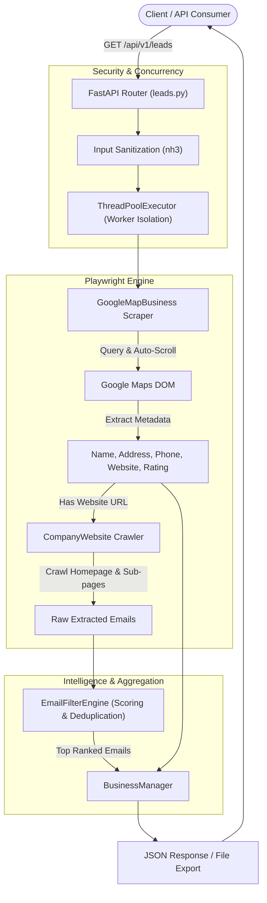

# 🏢 BusinessScraperEngine

An asynchronous, production-ready lead generation engine and REST API built with **FastAPI** and **Playwright**. It automates discovering targeted local businesses on Google Maps, extracts verified contact metadata, crawls company websites, and ranks executive contact emails using an intelligent, role-weighted heuristic engine.

[](https://www.python.org/)
[](https://fastapi.tiangolo.com/)
[](https://playwright.dev/)
[](https://www.docker.com/)
[](https://opensource.org/licenses/MIT)

---

## ✨ Key Features

- **🗺️ Targeted Google Maps Extraction**: Automates search queries, virtual wheel scrolling, and dynamic DOM parsing to extract business names, physical addresses, direct phone numbers, ratings, and websites.
- **🌐 Deep Company Website Crawling**: Automatically navigates to discovered company domains, extracting contact emails from page bodies, `mailto:` links, and navigational sub-pages (`/contact`, `/about`, `/locations`, `/support`, `/privacy-policy`).
- **🧠 Role-Weighted Email Scoring Engine**: Prioritizes decision-maker and business-critical inboxes (e.g., Compliance, Legal, CFO, CEO, Operations) while filtering out spam traps, autoresponders, bounces, and automated addresses (`noreply@`, `marketing@`, `press@`).
- **🛡️ Injection & XSS Protection**: Sanitizes all query parameters with `nh3` HTML scrubbing to prevent malicious query injection.
- **⚡ Non-Blocking Architecture**: Executes headless browser automation inside an isolated `ThreadPoolExecutor` with platform-specific event loop handling (`ProactorEventLoop` on Windows) to keep the FastAPI server responsive.
- **🐳 Cloud & Container Ready**: Includes a multi-stage `Dockerfile` based on Microsoft's official Playwright runtime, configured for one-click deployment on platforms like Render, AWS, and GCP.

---

## 🏗️ Architecture & Data Flow



---

## 🛠️ Tech Stack

| Component | Technology | Description |
| :--- | :--- | :--- |
| **API Framework** | [FastAPI](https://fastapi.tiangolo.com/) | Modern, high-performance web framework for building APIs |
| **ASGI Server** | [Uvicorn](https://www.uvicorn.org/) | Lightning-fast asynchronous server implementation |
| **Browser Automation** | [Playwright Python](https://playwright.dev/python/) | Headless browser automation for chromium |
| **Sanitization** | [nh3](https://github.com/messense/nh3) | Python bindings for Rust's Ammonia HTML sanitizer |
| **Data Processing** | [Pandas](https://pandas.pydata.org/), [OpenPyXL](https://openpyxl.readthedocs.io/) | Data manipulation and Excel/JSON export serialization |
| **Validation & Schema** | [Pydantic](https://docs.pydantic.dev/) & Dataclasses | Type validation and structured data modeling |
| **Containerization** | [Docker](https://www.docker.com/) | Container packaging with Playwright Linux runtime |

---

## 📁 Project Structure

```text
BusinessScraperEngine/
├── api/
│   ├── exception_handler/        # Global & validation exception handlers
│   │   ├── custom_exception_handler.py
│   │   └── global_exception_handler.py
│   ├── exceptions/               # Application-level custom exception classes
│   │   ├── custom_exception.py
│   │   └── global_exception.py
│   ├── routers/                  # API endpoints and route definitions
│   │   └── leads.py              # Main /leads extraction endpoint
│   └── main_router.py            # API v1 central routing hub
├── models/
│   └── businessModels.py         # Dataclasses (GoogleMapBusinessInfo, CompanyWebsiteInfo)
├── scrapers/
│   ├── company_info_scraper.py   # Website text & mailto: email harvester
│   └── google_map_scraper.py     # Google Maps locator & element selectors
├── services/
│   ├── businessManager.py        # Lead aggregation, JSON & Excel exporters
│   ├── company_website.py        # Website visit orchestrator
│   ├── email_filter_engine.py    # Role-based email scoring & keyword wash
│   └── google_map_business.py    # Google Maps navigation & scroll controller
├── data/                         # Saved JSON/Excel output files
├── .env                          # Environment configuration file
├── cli_main.py                   # Standalone CLI test script
├── config.py                     # Browser launch arguments and environment settings
├── Dockerfile                    # Production Docker container definition
├── main.py                       # FastAPI application entry point
└── requirements.txt              # Project Python dependencies
```

---

## 🚀 Getting Started

### Prerequisites

- **Python 3.10+**
- **pip** and **virtualenv**
- Node/Browser dependencies for Playwright

### 1. Clone the Repository

```bash
git clone https://github.com/your-username/BusinessScraperEngine.git
cd BusinessScraperEngine
```

### 2. Set Up Virtual Environment

```bash
# Windows (PowerShell)
python -m venv .venv
.\.venv\Scripts\Activate.ps1

# Linux / macOS
python3 -m venv .venv
source .venv/bin/activate
```

### 3. Install Dependencies & Playwright Browsers

```bash
pip install -r requirements.txt
playwright install chromium
```

---

## ⚙️ Environment Configuration

Create a `.env` file in the root directory:

```ini
# Environment mode: 'development' (shows browser UI) or 'production' (headless)
ENVIRONMENT=production

# Base URL for Google Maps service
GOOGLE_MAPS_URL=https://google.com/maps

# Port for the web server (defaults to 8000 locally, 10000 in Docker)
PORT=8000
```

### Configuration Parameters

| Variable | Type | Default | Description |
| :--- | :--- | :--- | :--- |
| `ENVIRONMENT` | string | `production` | Set to `development` to disable headless mode and watch Playwright interact with the browser. |
| `GOOGLE_MAPS_URL` | string | `https://google.com/maps` | Google Maps entry point URL. |
| `PORT` | integer | `8000` | Local port for FastAPI Uvicorn server. |

---

## 📖 API Documentation & Usage

### Starting the Server

```bash
python main.py
# or using uvicorn directly
uvicorn main:app --host 0.0.0.0 --port 8000 --reload
```

Once running, interactive API docs are available at:
- **Swagger UI**: `http://localhost:8000/docs`
- **ReDoc**: `http://localhost:8000/redoc`

---

### Endpoints

#### 1. Health Check
Checks service availability.

```http
GET /health
```

**Response (`200 OK`):**
```json
{
  "status": "ok"
}
```

---

#### 2. Scrape Leads
Search Google Maps for businesses, extract details, and scrape prioritized emails.

```http
GET /api/v1/leads
```

**Query Parameters:**

| Parameter | Type | Required | Default | Description |
| :--- | :--- | :---: | :---: | :--- |
| `search` | `string` | **Yes** | — | Target business niche or type (e.g., `dentist`, `real estate agency`). |
| `location` | `string` | **Yes** | — | Target city or area (e.g., `New York`, `London`). |
| `limit` | `integer` | No | `10` | Maximum number of businesses to scrape (Min: `1`, Max: `50`). |

**Example cURL Request:**
```bash
curl -X GET "http://localhost:8000/api/v1/leads?search=dentist&location=new%20york&limit=5"
```

**Example Response (`200 OK`):**
```json
{
  "status": "ok",
  "message": "Found 5 businesses",
  "result": [
    {
      "name": "Manhattan Dental Arts",
      "address": "400 Madison Ave Suite 9B, New York, NY 10017",
      "phone_number": "02125550192",
      "website": "https://manhattandentalarts.example.com",
      "rating": "4.9 stars 342 Reviews",
      "emails": [
        "compliance@manhattandentalarts.example.com",
        "contact@manhattandentalarts.example.com",
        "info@manhattandentalarts.example.com"
      ]
    }
  ]
}
```

---

### 🛡️ Error Responses

Standardized JSON error format:

* **Validation Error (`422 Unprocessable Entity`):**
  ```json
  {
    "status": "error",
    "message": "Validation failed: 'search': Field required"
  }
  ```

* **Malicious Input Detected (`403 Forbidden`):**
  ```json
  {
    "status": "error",
    "message": "Malicious scripting or tags detected in 'search and location'."
  }
  ```

* **Scraper Failure (`502 Bad Gateway`):**
  ```json
  {
    "status": "error",
    "message": "failed to retive data. Please try later."
  }
  ```

---

## 🎯 Email Scoring & Filtering System

The engine uses a weighted scoring algorithm to rank extracted email addresses so you always get the highest-value decision-makers first:

| Role Category | Sample Keywords | Weight / Priority |
| :--- | :--- | :---: |
| **Governance & Regulatory** | `compliance`, `regulatory`, `dpo`, `aml`, `risk` | **+80 to +100** |
| **Executive & Leadership** | `cfo`, `ceo`, `director`, `board`, `legal` | **+60 to +80** |
| **Operations & Billing** | `accounts`, `finance`, `billing`, `invoice` | **+45 to +55** |
| **General Inquiries** | `contact`, `info`, `support`, `enquiry` | **+15 to +30** |
| **Marketing & PR (Downranked)** | `media`, `marketing`, `newsletter`, `promo` | **-20 to -60** |
| **System & Automated (Blocked)** | `noreply`, `bounce`, `daemon`, `postmaster` | **Discarded** |

---

## 🐳 Docker Deployment

The application includes a production-ready `Dockerfile` based on Microsoft's official Playwright runtime (`mcr.microsoft.com/playwright/python:v1.49.0-noble`), which comes with all required Linux dependencies pre-installed.

### Build and Run Locally with Docker

```bash
# 1. Build the image
docker build -t business-scraper-engine .

# 2. Run container on port 10000
docker run -d \
  --name scraper-service \
  -p 10000:10000 \
  -e ENVIRONMENT=production \
  -e GOOGLE_MAPS_URL=https://google.com/maps \
  business-scraper-engine
```

Test the containerized endpoint:
```bash
curl http://localhost:10000/health
```

### Deploying to Cloud (Render / Railway / AWS ECS)

1. Connect your repository to **Render** (or equivalent cloud platform).
2. Select **Web Service** with **Docker** environment.
3. Configure the environment variables:
   - `ENVIRONMENT=production`
   - `GOOGLE_MAPS_URL=https://google.com/maps`
   - `PORT=10000`
4. The service will automatically build and start on Render's default port `10000`.

---

## 💡 Best Practices & Operational Notes

> [!TIP]
> **Local Debugging**: When developing or inspecting scraper selectors, set `ENVIRONMENT=development` in your `.env`. This disables headless mode, allowing you to visually watch Chromium execute search queries, scroll lists, and click listings.

> [!NOTE]
> **Windows Proactor Loop**: Playwright requires the `ProactorEventLoop` on Windows to handle subprocesses. The engine automatically handles this via `scrape_runner()` in `services/google_map_business.py`.

> [!IMPORTANT]
> **Container Memory Allocation**: Running Chromium headlessly requires adequate memory. For cloud deployments, allocate at least **1 GB RAM** (ideally 2 GB) to prevent Chromium processes from being killed during intensive multi-page crawls.

---

## 📄 License

This project is licensed under the [MIT License](LICENSE).
